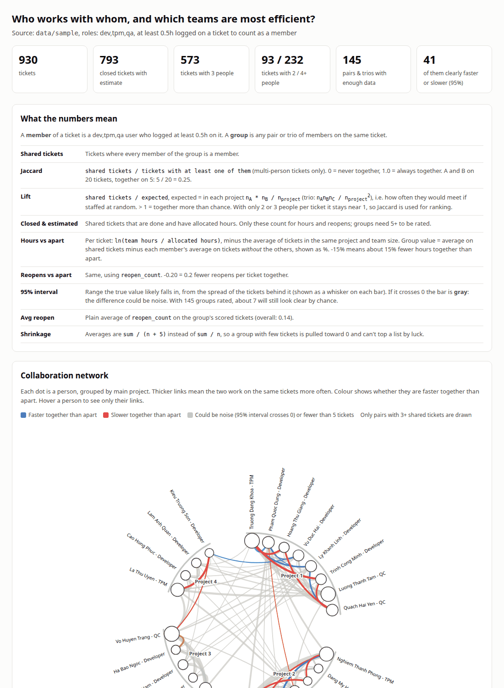

# team-collab-mining

Find out, from per-ticket working hours:

- **who works together** most often, and
- **which pairs and trios finish tasks faster** (or slower, or with more reopens) than the same
  people do apart.

Python 3.10+, standard library only, nothing to install. Reads the Odoo 17+ project and timesheet
schema, and ships with a synthetic dataset so you can try it in one minute.



## Quick start

```bash
git clone git@github.com:xaviedoanhduy/team-collab-mining.git
cd team-collab-mining
python3 analyze.py              # analyze data/sample/, print a summary, write reports/
xdg-open reports/report.html    # macOS: open reports/report.html
```

The terminal shows the strongest results; the HTML report has everything, with charts and hover
details. Other commands:

```bash
python3 generate_sample.py      # rebuild data/sample/ (same seed, same data)
python3 -m unittest -v          # check the analysis still finds the effects planted in the sample
```

## Use your own data

The input follows the standard Odoo 17+ models of the `project` and `hr_timesheet` modules, one CSV
per model. Other tools work too, as long as you produce the same columns.

### The CSV files

Only the **bold** columns are required; extra columns are ignored.

**hr_employee.csv**

| column | meaning |
|---|---|
| **id** | employee id |
| **role** | `dev`, `tpm`, `qa`, `pm` or `consultant` (`qa` is shown as QC) |
| name | label in the report: `Name - Role` (`#id - Role` when empty) |

**project_task.csv**

| column | meaning |
|---|---|
| **id** | task id |
| **project_id** | tasks are only compared within the same project |
| **state** | only `1_done` tasks count for hours and reopens |
| **allocated_hours** | estimate; `0` or empty = not estimated (skipped) |
| reopen_count | times the task was reopened; empty = 0 |

**account_analytic_line.csv** (timesheets)

| column | meaning |
|---|---|
| **task_id** | task the time was logged on; empty = skipped |
| **employee_id** | who logged it |
| **unit_amount** | hours |

## Reading the results

### One result, explained

```
                     (8 tickets / 237 tickets), 8 closed & estimated, 95% CI -23.7% to -5.3%
 -15.0%  ████████    - Pham Quoc Dung - Developer
                     - Ly Khanh Linh - Developer
```

- **8 tickets / 237 tickets**: both of them worked on 8 tickets; 237 multi-person tickets have at
  least one of them. 8 / 237 is their Jaccard (how often they are together).
- **8 closed & estimated**: those 8 are done and have allocated hours, so they can be scored.
- **-15.0%**: on those tickets they needed about 15% fewer hours than each of them needs on
  similar tickets without the other. Negative = faster together.
- **95% CI -23.7% to -5.3%**: 8 tickets is not much, so -15% is not exact. The true value is most
  likely somewhere in this range.

### The 95% interval (CI)

The interval says how sure the number is. What matters is whether it crosses 0 (no difference):

```
                              faster together 0 slower together
                                              |
 A  -15%  CI -24% to -5%          [===*=====] |   clear: faster
 B  +19%  CI +8% to +31%                      |   [=====*=====]   clear: slower
 C   -9%  CI -22% to +4%           [======*===|=]   crosses 0: could be noise
```

Left of 0 = negative = fewer hours. More tickets give a narrower interval. A wide
interval that crosses 0 does not mean "no effect"; it means "not enough data to tell".

95% also means about 1 result in 20 looks clear by pure chance: with 145 groups rated, expect
around 7 such false alarms. A single clear result on 5 tickets is a hint, not a fact.

### All metrics

| metric | meaning |
|---|---|
| shared tickets | tickets where every member of the group logged at least `--min-hours` |
| Jaccard | shared tickets / tickets with any of them. 0 = never together, 1 = always together. Compare within one role mix only: a TPM reviews most of a project, so Developer + TPM is naturally high. |
| hours vs apart | e.g. `-15%`: the group needs about 15% fewer hours together than its members need apart, on comparable tickets |
| reopens vs apart | e.g. `-0.16`: 0.16 fewer reopens per ticket together than apart |
| 95% CI | see above. Crosses 0 = marked **could be noise** (gray in the report). |
| closed & estimated | shared tickets used for hours and reopens; a group needs `--min-shared` (5) of them to be rated |

A clear result means the difference is stable, not that the pair causes it: who gets staffed on
which tickets matters too. Treat results as hints to look into, not verdicts.

### Outputs in `reports/`

| file | content |
|---|---|
| `report.html` | single page, no dependencies, light and dark: glossary, network, best/worst trios and pairs, reopens, most-together, full table |
| `groups.csv` | one row per pair or trio with every metric above, including `*_ci_low`, `*_ci_high`, `*_significant` |
| `huim_spmf.txt`, `huim_items.csv` | the same tasks in SPMF format (`items:TU:utilities`) for high-utility itemset mining tools |
| `users.csv` | only with `--show-individuals` |

## Options

| option | default | meaning |
|---|---|---|
| `--data` | `data/sample` | folder with the three CSV files |
| `--out` | `reports` | output folder |
| `--roles` | `dev,tpm,qa` | roles that count as team members (PMs only touch tickets briefly) |
| `--min-hours` | `0.5` | hours on a ticket to count as a member |
| `--min-shared` | `5` | closed & estimated shared tickets needed to rate a group |
| `--shrink` | `5` | pulls small groups toward 0 so luck doesn't top the list |
| `--top` | `8` | rows per best/worst list |
| `--min-edge` | `3` | shared tickets needed to draw a link in the network |
| `--show-individuals` | off | also rank individuals; off because this is a team tool, not a rating |

## How it works

1. **Team of a ticket**: users of the chosen roles who logged at least `--min-hours` on it.
   A typical ticket: 1 or 2 developers, the project's TPM (code review) and a QC.
2. **Groups**: every pair and trio inside a team.
3. **Hours per ticket**: `ln(team hours / allocated_hours)`, minus the average of
   tickets in the same project with the same team size. This residual is negative when the
   ticket went faster than comparable work.
4. **Reopens per ticket**: `reopen_count`, residual computed the same way.
5. **Together vs apart**: the group's average residual on shared tickets, minus each member's
   average on tickets **without the other members**. Using all of a member's tickets would mix
   the group's own effect into its baseline. Averages are `sum / (n + shrink)`.
6. **95% interval**: shared and apart tickets are separate sets, so their variances add. Each set
   uses at least the variance of all scored tickets, so a small uniform set (7 tickets, 0 reopens)
   doesn't get a falsely narrow interval. With ~150 groups rated, about 5% look clear by chance.

## Does it work? The sample dataset

`data/sample/` is synthetic: 930 tickets, 5 projects, 29 people, Jan 2025 to Oct 2026, with
realistic noise (individual speed, unestimated and open tickets, 2-dev tickets, one project without
QC). A few groups have effects planted on purpose; the tests check the analysis finds them.

| planted group | planted effect | analysis finds |
|---|---|---|
| dung.pham + linh.ly (Dev + Dev) | 0.7x dev hours, 0.5x reopens | best of 78 pairs, -15% (CI -24% to -5%) |
| khanh.ngo + phong.nghiem + thao.phan (Dev + TPM + QC) | 0.75x hours, 0.4x reopens | 3rd of 67 trios, -14%; fewest-reopens pair inside it |
| giang.hoang + khoa.truong + yen.quach (Dev + TPM + QC) | 1.35x hours, 1.8x reopens | worst trio, +26% (CI +15% to +38%) |
| son.kieu + trang.vo (Dev + QC) | 1.5x QC hours, 1.8x reopens | 2nd worst pair, +19%; reopens +0.19 but could be noise |
| long.mai + ngoc.ha (Dev + Dev) | usually staffed together | highest Jaccard among Dev + Dev |
| hieu.bui + lam.duong (Dev + Dev) | 1.45x hours, 2x reopens | **not rated**: only 1 closed & estimated shared ticket |
| hoa.do + thao.phan (Dev + QC) | 0.6x QC hours, 0.4x reopens | **missed**: QC is ~15% of a ticket's hours |

Known limits, all visible above:

- Rare combinations can't be judged.
- Reopens are a weak signal (0.14 per ticket on average); most planted reopen effects stay "could be noise".
- An effect on one part of the work (QC time only) drowns in total hours.
- Some unplanted groups look clear because they share a member with a planted group.

## Before using real data

- Working hours are personal data. Agree on the purpose with the people concerned first, and
  present results as team-composition hints, never as individual ratings.
- Once people know the metric, the way they log time changes.
- Estimates are set by people and carry their own bias.

## Project layout

| file | purpose |
|---|---|
| `analyze.py` | loading, analysis, terminal summary, CSV and SPMF output |
| `report.py` | the HTML report |
| `generate_sample.py` | synthetic dataset with planted effects |
| `test_analyze.py` | tests against the planted effects |

## License

MIT, see [LICENSE](LICENSE).
